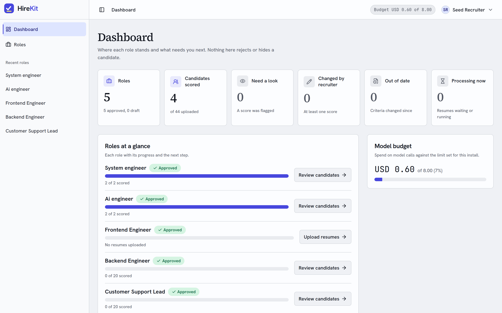
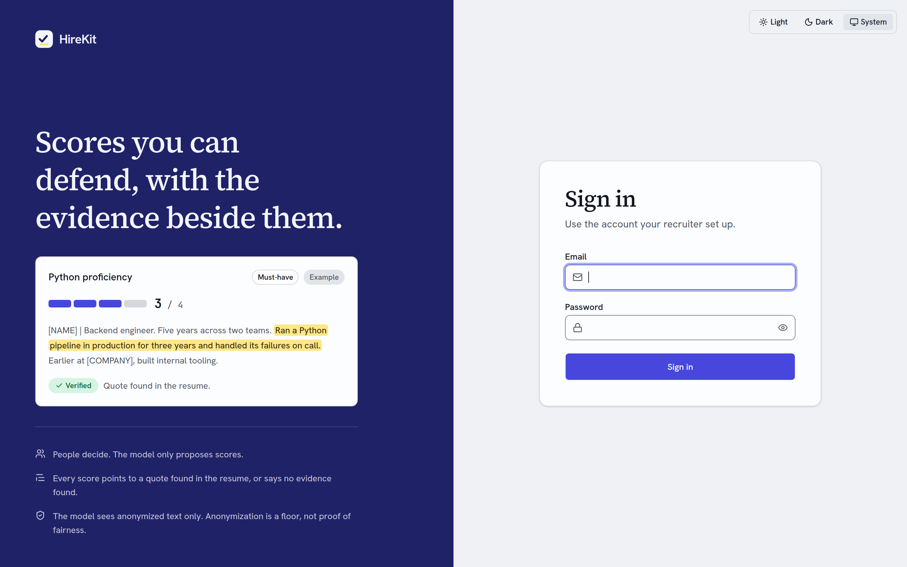
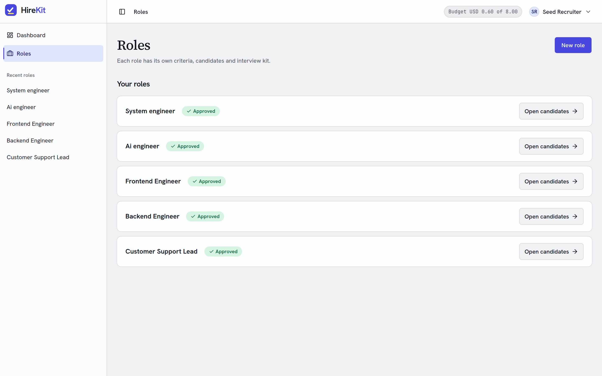
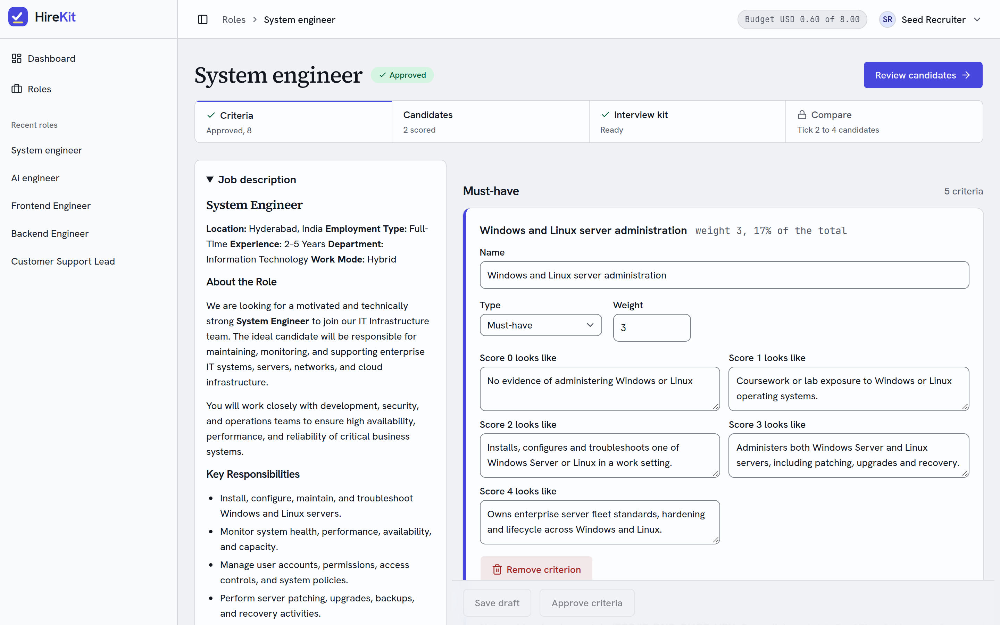

<p align="center">
  
</p>

<p align="center"><strong>Resume screening where every score shows its evidence.</strong></p>

<p align="center">
  <a href="https://github.com/venkatmidhunmareedu/hirekit/actions/workflows/ci.yml"></a>
  
  
  
  
</p>

<p align="center">
  
</p>

Structured, evidence-backed, anonymized resume screening. A recruiter defines a role and its criteria, uploads resumes, and reviews a ranked list where every score points to a quote found in the anonymized resume, or says "no evidence found". People make every decision; the model only proposes.

- Product: [PRD.md](PRD.md), [PRODUCT.md](PRODUCT.md)
- UI rules: [Design.md](Design.md)
- Build plan: [docs/designs/hirekit-build-plan.md](docs/designs/hirekit-build-plan.md)
- Decisions: [docs/decisions.md](docs/decisions.md) (ADRs in [docs/adr/](docs/adr/))
- Agent rules: [AGENTS.md](AGENTS.md)

## Screenshots

| | |
| --- | --- |
|  |  |
| Sign in, with an example of a score and its evidence | Roles, each with its own criteria, candidates and kit |
|  |  |
| A role's job description and editable criteria | Where each role stands, and the model budget |

## How it behaves

- The model only sees anonymized text. One gateway function is the only path to the model; it refuses non-anonymized input, caps `max_tokens` at 1500, logs every call and stops at USD 8 in total.
- A score has a quote that code found in the anonymized text (whitespace-normalized match, no fuzzy matching), or "no evidence found".
- Nothing rejects, hides or re-stages a candidate except a recruiter action.
- Anonymization is a floor, not proof of fairness. Schools, clubs, gendered wording and career gaps can remain.
- Tests and CI use recorded model responses only. A missing recording fails the test.

## Layout

| Path | What it holds |
| --- | --- |
| `backend/` | Python 3.14, FastAPI, PostgreSQL, the worker, Alembic migrations, evals, recordings |
| `web/` | React 19, Vite, Tailwind and shadcn/ui, TanStack Query and Router, Tiptap |
| `seed/` | Seed roles, resumes and labels for demos and evals |
| `deploy/oracle/` | Dockerfiles, Caddyfile and compose files for the single-VM deployment |
| `docs/` | ADRs, designs, API reference, progress notes |

Every command is a Makefile target at the root; it delegates to `backend/` and `web/`. `make help` lists them.

## Run it locally

You need Docker, `uv` and `pnpm`.

```bash
make setup          # Python deps, web deps and git hooks
cp backend/.env.example backend/.env   # then fill in the placeholders
make db             # Postgres in Docker
make migrate        # create the schema
make seed           # roles, resumes and two sign-in users
make dev            # API on :8080
make worker         # worker in replay mode (recorded responses, no spend)
make dev-web        # web dev server, proxies /v1 to the API
```

`make seed` prints each seeded user's password once, to the terminal (`recruiter@hirekit.local` and `interviewer@hirekit.local`). See [seed/README.md](seed/README.md) to choose passwords or reset them.

`make worker-live` runs the worker against the live model. It spends real money, capped at USD 8, and needs `OPENROUTER_API_KEY` in `backend/.env`. Never commit that file.

## Check your change

```bash
make check          # the gate CI runs: format, lint, types, tests, dependency audit
make test           # unit tests only
make eval           # agreement and name-swap evals on recordings (replay only)
```

`make check` runs the backend and web gates. A gate with nothing to check fails rather than passes.

The 40-resume agreement eval is a consistency check: the same model family wrote the resumes, the labels and the scores. It does not show that scoring is fair.

## Deploy

The API, worker and web app run on one Oracle VM. See [deploy/oracle/README.md](deploy/oracle/README.md) and ADR-0014. `make images` builds and pushes the images; `make vm-copy` and `make vm-up` ship and start them.

## Contributing

Work on a task branch named `feature|bugfix|chore|docs/<ID>-<PascalName>`; never commit to `main`. Commits are Conventional with the task id at the end of the subject, for example `feat(web): add review tabs [HK-86]`. Open a pull request; the gate must pass. Details are in [AGENTS.md](AGENTS.md).
